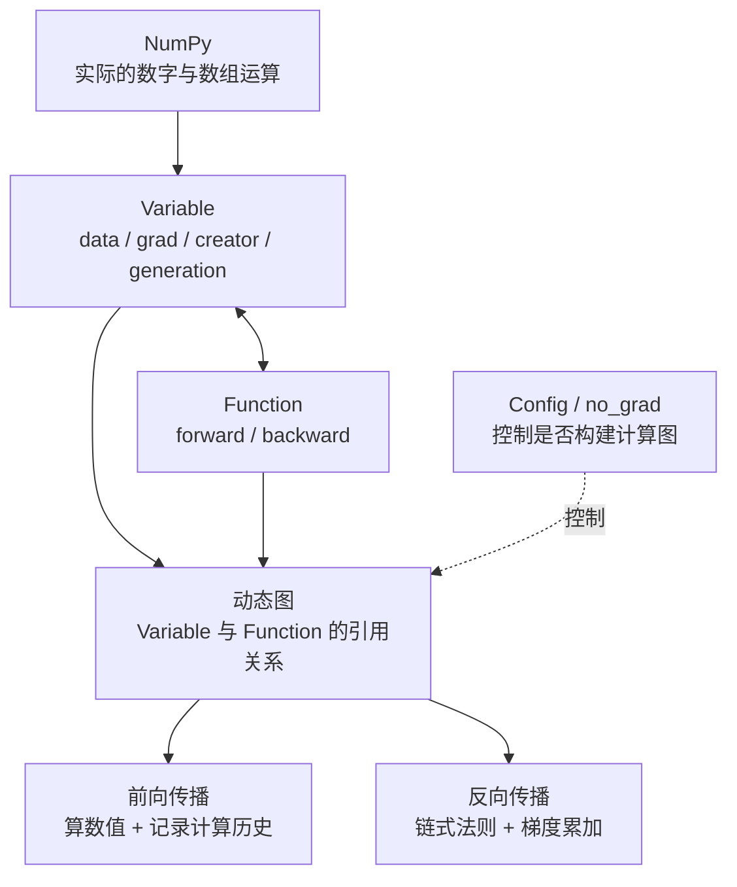
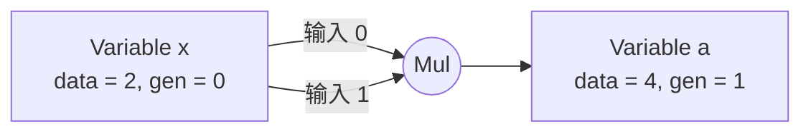
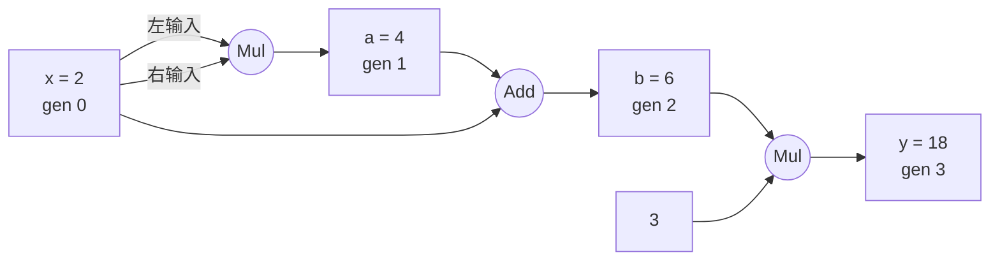

# LearnDL v0.2：核心架构、代码精简与自动求导全流程

> **定位**：以学习自动微分原理为核心，而不是追求与 PyTorch 竞争的性能或功能完整性。
>
> **审查范围**：本次提供的 `dezero/core_simple.py` 与 `dezero/__init__.py`。
>
> **阅读目标**：看完后能不打开 IDE，在脑中还原 `Variable → Function → 计算图 → backward` 的完整流程。

---

## 0. 先给结论

**当前代码已经足够简洁，不需要大幅重构。**

这套教学框架的价值，不在于把代码压缩到最少，而在于把自动求导的关键机制清楚地展示出来：

1. **Variable**：让 NumPy 数组能够携带梯度与计算历史。
2. **Function**：统一封装每一步运算的前向计算与局部求导。
3. **动态图**：运算发生时，自动建立 `Variable` 和 `Function` 之间的引用关系。
4. **反向传播**：从输出开始，根据链式法则反向遍历，累加各条路径的梯度。

### 代码审查速览

| 项目 | 结论 | 建议 |
| --- | --- | --- |
| 整体架构 | 结构合理、职责清晰 | 保持 `Variable + Function` 的核心设计 |
| 基本自动求导 | 支持基本标量运算、分支和梯度累加 | 不必改动主逻辑 |
| 反向遍历 | 使用 `generation` 和 `seen_set` 保证处理顺序 | 保留，不能为了简短删掉 |
| 多输出处理 | 利用 `weakref` 与 `output_specs` 处理无梯度输出 | 保留，并写明作用 |
| 广播求导 | **存在边界限制**：反向时未对广播维度做梯度归约 | 后续张量阶段引入 `sum_to` |
| `Function` 实例复用 | **存在边界限制**：同一实例多次调用可能覆盖计算历史 | 当前每次通过包装函数创建新实例即可 |
| 重复代码 | 部分辅助函数重复调用 `as_array()` | 可小范围清理 |
| 高阶导数 | `grad` 当前是 NumPy 数组，不支持通过求导过程构建高阶导数图 | 留待后续版本 |

**建议：先做一轮小范围清理，明确现有边界，再冻结 v0.2。**

---

## 1. 先在脑中放下这张总图



这张图只需要记住一句话：

> **NumPy 负责算数字，Variable 负责记住数据与来源，Function 负责定义每一步怎么算、怎么求导，反向传播负责把局部梯度串起来。**

代码中**没有专门的 `Graph` 类**。计算图是对象之间的引用关系自然形成的：

- `Variable.creator` 指向生成它的 `Function`；
- `Function.inputs` 保存本次运算的输入 `Variable`；
- `Function.outputs` 保存本次输出的弱引用。

这就是“动态图”的关键：**边执行，边建图**。

---

## 2. 两个核心角色

### 2.1 Variable：会“记住来历”的数据

```python
x = Variable(np.array(2.0))
```

把 `x` 想象成一张卡片：

| 属性 | 初始值 | 作用 |
| --- | --- | --- |
| `data` | `np.array(2.0)` | 保存实际数据 |
| `grad` | `None` | 保存梯度，反向传播时填充 |
| `creator` | `None` | 保存是谁生成了当前变量 |
| `generation` | `0` | 标记所在计算层次，帮助确定反向传播顺序 |
| `name` | `None` | 可选的变量名称 |

**Variable 不是新的数值计算引擎。** 真正执行 `+`、`*`、`**` 的仍然是 NumPy；Variable 额外携带的是自动求导所需的元数据。

### 2.2 Function：只管一次运算的规则

例如乘法：

```python
class Mul(Function):
    def forward(self, x0, x1):
        return x0 * x1

    def backward(self, gy):
        x0, x1 = self.inputs[0].data, self.inputs[1].data
        return gy * x1, gy * x0
```

- `forward()`：根据输入数值求输出数值。
- `backward()`：根据当前输出梯度 `gy`，求各输入的梯度贡献。

这个类**不负责全局遍历**、**不负责管理整张图**。这些都是基类 `Function.__call__()` 和 `Variable.backward()` 的职责。

这种设计很重要：以后新增一个运算，通常只需写清它的 `forward` 与 `backward`。

---

## 3. 走通一个完整例子

取下面这个函数：

$$
y = 3(x^2+x), \qquad x=2
$$

实际代码：

```python
import numpy as np
from dezero import Variable

x = Variable(np.array(2.0))

a = x * x
b = a + x
y = 3 * b

y.backward()

print(y.data)  # 18.0
print(x.grad)  # 15.0
```

### 3.1 第一步：建立输入变量

```python
x = Variable(np.array(2.0))
```

此时只有一个变量，没有运算历史：

```text
x
├── data       = 2.0
├── grad       = None
├── creator    = None
└── generation = 0
```

### 3.2 第二步：执行 `a = x * x`

表面上只有一行：

```python
a = x * x
```

但内部按以下顺序发生：

```text
Python 运算符 x * x
        │
        ▼
Variable.__mul__（由 setup_variable 绑定）
        │
        ▼
mul(x, x)
        │
        ▼
Mul()(x, x)
        │
        ▼
Function.__call__()
        │
        ├── 1. 将输入转换成 Variable
        ├── 2. 提取每个输入的 .data
        ├── 3. 调用 Mul.forward()
        ├── 4. 将结果 4.0 包装为新的 Variable
        └── 5. 记录 creator、inputs、outputs、generation
```

执行结束后，不仅得到 `a.data == 4.0`，还留下了运算关系：



> **关键认识**：前向计算的产物不仅是数值，也是下一次反向求导所需的“道路”。

### 3.3 第三步：把后续运算接到图上

接下来：

```python
b = a + x
y = 3 * b
```

便形成一张带有分支的计算图：



其中 `x` 同时进入了 `Mul` 与 `Add`。这意味着反向传播时，**多个分支对 `x` 的梯度贡献必须相加**。

### 3.4 第四步：从 `y.backward()` 倒着走

首先，输出对自身的导数是 1：

$$
\frac{\partial y}{\partial y}=1
$$

此后沿计算图逆向求导。

**第一段：`y = 3b`**

$$
\frac{\partial y}{\partial b}=3
$$

所以传给 `b` 的梯度是 `3`。

**第二段：`b = a + x`**

加法对两个输入的局部导数都是 1，所以：

$$
\frac{\partial y}{\partial a}=3,\qquad
\left.\frac{\partial y}{\partial x}\right|_{\text{Add 分支}}=3
$$

**第三段：`a = x * x`**

乘法的两个输入都是同一个 `x`，每个输入位置都会回传一份梯度：

$$
3\times 2=6,\qquad 3\times 2=6
$$

因此 `Mul` 为 `x` 贡献 `6 + 6 = 12`。

**最后，把所有路径贡献相加：**

$$
\frac{\mathrm dy}{\mathrm dx}
=3+6+6
=\boxed{15}
$$

这与手工求导相同：

$$
y=3x^2+3x\quad\Longrightarrow\quad
\frac{\mathrm dy}{\mathrm dx}=6x+3
$$

当 $x=2$ 时，梯度等于 15。

> **记忆重点**：反向传播不是“记住复杂的整体求导公式”，而是**每一步局部求导、沿路径相乘、遇到分支就累加**。

---

## 4. `backward()` 为什么不只是简单倒序调用？

你的实现维护三个关键对象：

```python
funcs = []
seen_set = set()

# 每个函数也记录了 generation
```

| 机制 | 解决的问题 |
| --- | --- |
| `funcs` | 哪些 `Function` 还需要处理？ |
| `seen_set` | 同一个 `Function` 会不会被重复加入待处理队列？ |
| `generation` | 如果存在分支，先处理哪一层才能正确累加梯度？ |

核心思路是：

```text
1. 输出变量的梯度默认为 1
2. 把输出变量的 creator 加入待处理列表
3. 优先取 generation 较大的 Function
4. 收集该 Function 各输出的梯度
5. 调用这个 Function 的 backward()
6. 将结果累加到各输入 Variable.grad
7. 把输入的 creator 继续加入列表
8. 重复，直到没有待处理的 Function
```

### 4.1 为什么要累加？

关键逻辑是：

```python
if x.grad is None:
    x.grad = gx
else:
    x.grad = x.grad + gx
```

原因很简单：一个变量可以沿多条路径影响最终输出。如果直接覆盖 `.grad`，之前路径的梯度就丢失了。

### 4.2 `generation` 在防止什么问题？

对于带分支的图，一个较早的节点可能有多个后继运算。如果它太早执行反向传播，上游变量可能还未收到所有下游梯度。

本实现把更靠近输出端、`generation` 更大的 `Function` 优先弹出处理，从而使梯度先在下游汇总，再继续往上游传播。

### 4.3 `retain_grad=False` 有什么用？

每处理完一个 `Function`，默认清空该函数输出的中间梯度，避免不必要的内存占用。

```python
y.backward(retain_grad=False)
```

最终的输入梯度仍可以保留；中间变量的 `.grad` 不一定保留。调试中间梯度时可以传 `retain_grad=True`。

### 4.4 为什么需要 `weakref` 和 `output_specs`？

`Function.outputs` 保存的是输出变量的弱引用，而不是永远强引用所有输出对象。

如果某个 `Function` 产生多个输出，其中一个结果没有被后续计算使用，它可能已经被释放。你的实现用 `output_specs` 保存该输出的形状和 dtype，在这种情况下补入对应形状的零梯度。

这一部分看上去比普通教学版复杂，但有明确用途。**不是无意义的冗余代码。**

---

## 5. 逐个记住这些辅助组件

| 组件 | 一句话解释 |
| --- | --- |
| `Variable` | 数据、梯度和计算来源的容器 |
| `Function` | 运算执行和求导规则的公共基类 |
| `Square`、`Add`、`Sub`、`Mul`、`Neg`、`Div`、`Pow` | 具体运算及其局部导数 |
| `as_array()` | 将 NumPy 标量或 Python 标量统一包装为数组 |
| `as_variable()` | 已经是 Variable 就原样返回，否则包装成 Variable |
| `setup_variable()` | 把 Python 的 `+ - * / **` 接到对应运算函数 |
| `__array_priority__` | 提高 Variable 与 NumPy 运算时的优先级 |
| `generation` | 决定反向处理次序 |
| `weakref` | 避免不必要的输出强引用与引用环 |
| `cleargrad()` | 清除之前留下的梯度，便于重新求导 |
| `Config.enable_backprop` | 决定前向过程中要不要记录求导图 |
| `using_config()` | 临时切换配置，结束后恢复原值 |
| `no_grad()` | 无需梯度的前向计算模式 |
| `__init__.py` | 统一导出主要接口并执行 `setup_variable()` |

### `no_grad()` 的直觉

```python
from dezero import no_grad

with no_grad():
    y = x * x
```

数值仍会计算，但不会把这次运算接入自动求导图。

这是理解训练与推理差异时非常有用的一块基础。

---

## 6. 代码还能精简吗？

### 6.1 建议做：删除重复的输入转换

例如原本：

```python
def add(x0, x1):
    x1 = as_array(x1)
    return Add()(x0, x1)
```

可以简化成：

```python
def add(x0, x1):
    return Add()(x0, x1)
```

原因是 `Function.__call__()` 已经执行了：

```python
inputs = [as_variable(x) for x in inputs]
```

而 `as_variable()` 在需要包装新变量时，会自行调用 `as_array()`。

同理，`sub()`、`rsub()`、`mul()`、`div()`、`rdiv()` 中的重复 `as_array(x1)` 也可删除。反向运算符仍要**保留原有参数交换次序**，例如：

```python
def rsub(x0, x1):
    return Sub()(x1, x0)


def rdiv(x0, x1):
    return Div()(x1, x0)
```

### 6.2 可以做：清理过时注释与语法细节

- 删除已注释的旧 `gys` 实现，以及已经注释的旧 `__mul__` 方法。
- `class Function(object):` 可改成 `class Function:`。
- 可整理类、方法之间的空行和注释，统一为一个稳定的代码风格。

这些属于**可读性整理**，对学习收益比进一步抽象更高。

### 6.3 不建议做：为省代码行数而删掉运算类

虽然减法可以表示为加法与取负，除法也能由乘法与负指数表达，但这个学习阶段，明确看到：

```text
Sub.forward()  → 减法如何计算？
Sub.backward() → 减法如何求导？

Div.forward()  → 除法如何计算？
Div.backward() → 除法如何求导？
```

比省下几十行代码更有价值。

**也不建议现在引入复杂队列调度器、额外抽象层、性能优化框架。** 这些会分散对自动微分本质的注意力。

---

## 7. 两个需要明确记录的限制

### 7.1 NumPy 广播的梯度还未正确归约

示例：

```python
x = Variable(np.array([1.0, 2.0, 3.0]))
b = Variable(np.array(2.0))

y = x + b
y.backward()
```

期望：

```python
b.grad  # np.array(3.0)，标量
```

但当前 `Add.backward()` 直接返回 `(gy, gy)`，得到的是形状为 `(3,)` 的梯度，而不是 `b` 原本的标量形状。

原因：**NumPy 前向可以自动广播，反向却必须把广播出去的维度求和，才能还原到输入形状。**

处理建议：当前主要学习标量自动求导时可以先记录此限制；进入张量、广播、矩阵运算阶段后，再引入 `sum_to` 等机制。

### 7.2 同一个 Function 实例不能安全地反复使用

不要把下面的写法当成受支持的正常用法：

```python
f = Square()
a = f(x)
b = f(a)  # 会覆盖 f 中前一次计算保存的输入/输出历史
```

原因是 `Function.__call__()` 会在 `self` 上保存本次运算的 `inputs`、`outputs`、`generation` 等信息。第二次调用会覆盖第一次的记录。

当前正确的日常写法是：

```python
a = square(x)
b = square(a)
```

因为 `square()` 每次都会生成新的 `Square()` 对象。类似地，`add()` 和 `mul()` 也会创建各自新的 Function 实例。

这一约束在现在的教学架构下可以接受，但建议写入文档，避免误用。

---

## 8. 当前实现和 PyTorch 之间的界限

当前的 `core_simple.py` 已经实现了**基础的反向模式自动微分**，但不是完整的深度学习框架。

特别要理解：

- `.grad` 目前是 NumPy 数组，不是能够继续自动求导的 Variable。
- `backward()` 内部的梯度计算主要用 NumPy，因此还不能自动构建高阶导数的计算图。
- 张量广播的梯度归约尚未实现。
- 参数管理、优化器、神经网络层等还不属于本次上传的两个文件的实现范围。

这不是失败，而是**刻意控制学习范围**。

LearnDL 的价值是学透“底层为什么成立”；OCR、VLM 等高层算法则可在其他项目中利用 PyTorch 学习与实现。两条路线是互补的。

---

## 9. 闭眼复述：整个系统只剩下六句话

> 1. 我的 LearnDL 底层使用 NumPy 真正执行数值计算。
> 2. `Variable` 包装 NumPy 数组，并保存 `data`、`grad`、`creator` 和 `generation`。
> 3. `Function` 定义每一步的 `forward()` 和 `backward()`。
> 4. 每发生一次运算，`Function.__call__()` 计算结果，并通过对象引用记录这次计算，动态图因此形成。
> 5. 调用 `Variable.backward()` 后，从输出梯度 1 出发，沿 `creator` 逆向寻找 Function，用各自的 `backward()` 计算局部梯度。
> 6. 借助 `generation` 决定遍历顺序，遇到分支累加梯度，直到得到输入变量对输出的导数。

**记忆口诀：包装数据 → 执行运算 → 记录关系 → 逆向遍历 → 局部求导 → 累加梯度。**

### 你可以用这三个问题检查自己是否掌握

1. 为什么没有 `Graph` 类，框架却能自动构建计算图？
2. 为什么 `x * x` 会向同一个 `x.grad` 累加两份梯度？
3. 为什么反向传播需要 `generation`，而不能不加区分地立即处理每个 `creator`？

能不看源码解释清楚这三题，再默写出 `Variable`、`Function.__call__()` 和 `Variable.backward()` 的骨架，就说明 v0.2 的核心学习目标基本达到了。

---

## 10. v0.2 封版建议

- [ ] 保留 `Variable + Function` 的核心架构，不做大规模重构。
- [ ] 删除辅助函数中重复的 `as_array()` 调用。
- [ ] 删除过时注释、统一格式。
- [ ] 在文档中记录广播梯度与 Function 实例复用的限制。
- [ ] 用已有测试继续回归验证基础运算、反向运算符、分支累加、多输出、`no_grad()`。
- [ ] 完成上述小清理后冻结 v0.2，进入后续学习阶段。

> **最终判断**：不要为了“更像成熟框架”把这份教学代码改复杂。当前最重要的是理解得更深，而不是写得更短。

---

*说明：本文基于当前提供的 `core_simple.py` 和 `__init__.py` 梳理。计算图使用标准 Mermaid 代码块，GitHub 支持直接预览；其他 Markdown 编辑器需开启 Mermaid 支持。*
